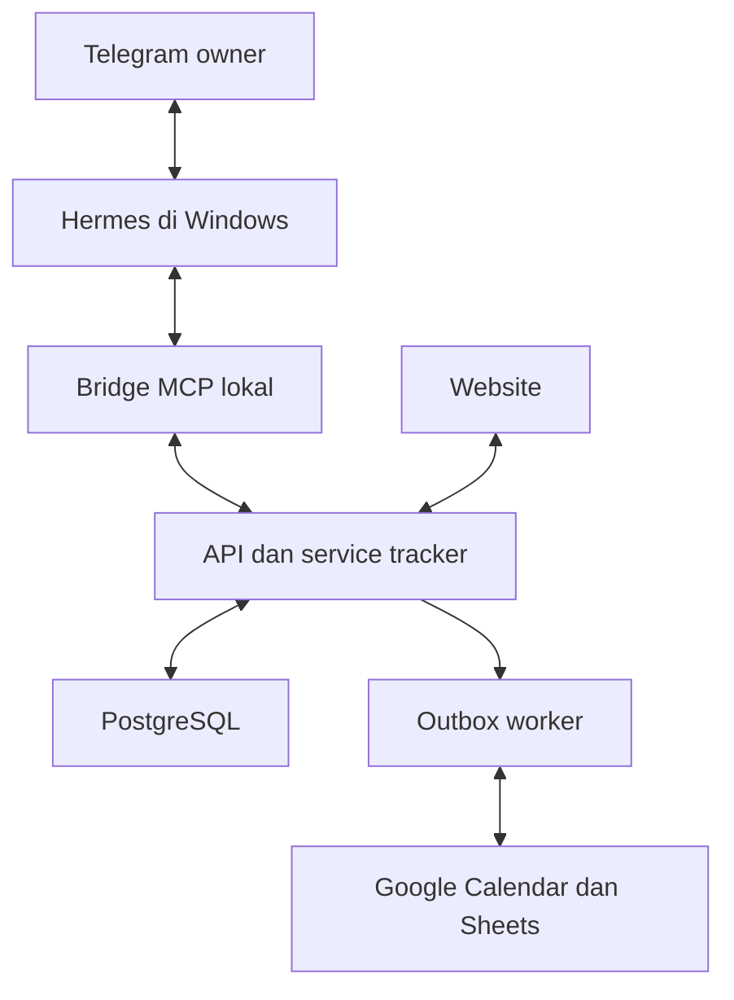

# Kontrak Hermes Telegram dan Tracker

Versi 3.2 | 5 November 2026 | Status: desain target untuk Codex, belum diimplementasikan.

## 1 Batas sistem

Telegram menjadi antarmuka percakapan. Hermes lokal mengolah bahasa dan memakai tool. MCP bridge lokal menerjemahkan tool menjadi panggilan HTTP ke backend tracker. Website dan bridge memakai service domain dan database yang sama. Google tetap diakses worker backend. Codex hanya bekerja pada fase pembangunan.

Diagram adalah rancangan. Semua panggilan model Hermes diarahkan ke laptop Windows. Ollama dengan endpoint loopback menjadi default implementasi. Model harus lolos uji tool calling dan konteks pada hardware pemilik; fallback cloud dinonaktifkan. Tidak ada kebutuhan menghubungkan akun Codex ke Hermes.

## 2 Pilihan transport dan proses

- Default bridge: proses Node.js stdio di `tools/tracker-mcp`; dijalankan sebagai child process Hermes. Stdout hanya pesan protokol; diagnostik aman ke stderr.
- Backend lokal: `http://127.0.0.1:3000` atau origin loopback yang dipilih dan dikonfigurasi. HTTP hanya diperbolehkan untuk loopback eksplisit pada development. Target ter-hosting wajib HTTPS.
- Adapter tidak membuka port inbound publik. Telegram menggunakan transport polling yang disediakan gateway Hermes pada pilot; jangan memasang webhook website atau poller kedua. Pastikan konfigurasi aktual adapter mendukung keputusan ini.
- Origin tracker ditetapkan dalam konfigurasi trusted; model tidak dapat menentukan base URL, header, proxy atau method HTTP.
- Pin dependency dan versi Hermes yang diuji. Script npm `build:mcp` adalah deliverable yang diminta, bukan perintah yang sudah ada di repo kosong.
- Reader dan capture tetap dapat diuji tanpa provider LLM memakai contract harness. Uji model dan Telegram terpisah.

## 3 Identitas dan credential

Owner login di website lalu membuat credential integrasi di Settings > Hermes. Server menghasilkan secret acak kriptografis minimal 256 bit, hanya memperlihatkan token sekali, menyimpan hash/HMAC yang aman beserta prefix nonsecret, owner_id, scopes, expires_at, revoked_at dan last_used_at. Usulan expiry awal 30 hari; tampilkan sebelum penerbitan dan dapat dikurangi. Backend memeriksa expiry/revocation pada setiap request.

Scope tepat: `opportunities:read`, `agenda:read`, `drafts:create`. Tidak menerima owner_id dari body/query. Token hanya untuk agent routes; token ditolak pada admin, export, file download, Google, cron dan endpoint mutation website. Session cookie tidak dipindahkan ke Hermes. Cookie routes tetap memakai proteksi sesi dan origin sendiri.

Simpan token di credential file lokal di luar repo, hanya dapat dibaca akun Windows yang menjalankan Hermes. File dibaca bridge; jangan menaruh nilainya dalam YAML, prompt, query string, argumen command atau log. Jangan memberi Hermes database URL, service-role key, OAuth Google token, GitHub token atau kredensial Codex. Backend hosted menyimpan hash, bukan token plaintext.

Allowlist numeric Telegram user ID pada Hermes adalah lapisan akses kanal. Bot hanya private owner; nonaktifkan penambahan ke grup via BotFather dan jangan izinkan grup/channel pada konfigurasi pilot. Verifikasi melalui H02 bahwa grup tidak menampilkan data meskipun pengirim adalah owner. Bila versi Hermes tetap bisa menerima grup, pasang guard transport private-chat sebelum akses tool; jangan percaya `chat_type` yang ditulis model. Jangan menyatakan private-only hanya karena allowlist user telah diisi.

## 4 Daftar tool yang diizinkan

| Tool MCP | Input yang boleh diisi model | Endpoint backend usulan | Scope |
|---|---|---|---|
| search_opportunities | query max 200 karakter; category; stage; arrangement; max_employer_hours; include_unknown_hours; cursor; limit 1–20 | GET /api/agent/opportunities | opportunities:read |
| get_opportunity | opportunity_id UUID | GET /api/agent/opportunities/:id | opportunities:read |
| get_upcoming_deadlines | start_date dan end_date ISO date; category; cursor; limit 1–50; jendela max 31 hari | GET /api/agent/deadlines | agenda:read |
| create_draft | source_url atau source_text atau title; category opsional | POST /api/agent/drafts | drafts:create |

Schema strict, additionalProperties=false. Kategori kosong tetap draft unclassified di Inbox sampai dipilih; tidak diasumsikan job. `source_text` dibatasi 20.000 karakter dan URL 2.048. Backend memvalidasi ukuran byte total max 64 KiB, Unicode, scheme URL dan tanggal kalender. Input tak dikenal menghasilkan 400 tanpa silent coercion. Nilai batas ini keputusan desain yang dapat dituning dengan bukti.

Tidak ada tool SQL, arbitrary HTTP, shell, search internet, file ekspor, update_opportunity, delete, create_calendar_event atau deploy pada profile pilot. Perintah yang melampaui akses dijelaskan singkat dan diarahkan ke tautan website yang relevan. Tool discovery harus mengembalikan tepat empat tool ini. Hidden tool di frontend bukan kontrol otorisasi; backend wajib menolak.

## 5 Data minimum untuk jawaban

List mengembalikan id, category, title, organization, personal_stage, posting_status, eligibility, arrangement, employer_hours, remote eligibility, deadline ringkas, revision, app_url dan bukti publik ringkas yang diperlukan. Detail boleh menambah syarat, kompensasi, source URLs dan timestamp verifikasi. Jangan mengirim kontak HR, CV, file links bertoken, raw research text panjang atau seluruh notes pribadi secara default.

Deadline tool membaca milestones database, bukan detail kalender pribadi. Ini bukan janji bahwa agenda pengguna kosong atau bebas bentrok. Jika jawaban menyebut hasil pemeriksaan konflik, hanya boleh memakai hasil pemeriksaan backend dengan coverage dan freshness yang eksplisit; tool pilot tidak menjanjikan pemeriksaan FreeBusy baru. Data null harus tetap null.

Envelope respons: `schema_version`, `request_id`, `data_as_of` UTC, `timezone=Asia/Jakarta`, `items` atau `item`, `next_cursor`, `warnings`, `partial`. Evidence memiliki source_url dan source_checked_at terpisah dari waktu query. Jangan menafsirkan data_as_of sebagai verifikasi ulang isi lowongan. app_url berasal dari APP_URL server, tidak dari sumber eksternal.

Contoh sintetis ada di `examples/agent_response.synthetic.json`. Jawaban Hermes menyebut tanggal pengecekan sumber untuk klaim kelayakan/freshness, tautan detail tracker, dan ketidakpastian penting. Hasil 20 baris dengan next_cursor tidak boleh disebut seluruh data. Ambiguitas beberapa perusahaan/posisi harus ditanyakan atau ditampilkan sebagai pilihan.

## 6 Create draft dan idempotensi

1. Hermes hanya memanggil create_draft bila pengguna jelas meminta menyimpan. Tautan tanpa konteks memerlukan klarifikasi niat; tidak ada auto-submit.
2. Bridge memvalidasi input dan membuat capture intent acak, menyimpannya secara atomik pada ledger lokal sebelum request. Backend menerima `Idempotency-Key` yang dihasilkan bridge. Model tidak mengendalikan owner/actor/credential.
3. Untuk retry timeout dalam intent yang sama, bridge mempertahankan key dan payload hash, termasuk sesudah restart. Jangan membuat key baru sampai receipt atau status rekonsiliasi diketahui. Retensi ledger pending minimum 7 hari pada pilot.
4. Backend memvalidasi grant dan menyimpan idempotency key, payload hash, hasil, draft/source, audit dan outbox ekstraksi dalam transaksi. Unique index `(owner_id, integration_id, idempotency_key)`; key sama dengan payload berbeda -> 409.
5. Exact external identity/canonical URL di owner yang sama diperiksa pada transaksi yang aman terhadap concurrency. Query job ID dipertahankan. Duplikat identik mengembalikan record existing tanpa overwrite stage, notes atau field reviewed. Teks identik dapat dikembalikan sebagai duplicate candidate; similarity saja tidak auto merge.
6. Cross-turn baru atau capture website memiliki key berbeda tetapi menggunakan aturan exact identity yang sama. Unique identity dan retry transaksi mencegah race dua kanal. Kandidat ambigu tersimpan sebagai proposal review yang merujuk sumber, bukan merge paksa.
7. Receipt memuat `outcome=created|existing|review_required`, `opportunity_id`, `revision`, `saved_at`, `app_url`, `extraction_status`. HTTP 201 untuk created, 200 untuk existing/replay, 409 untuk key conflict. URL fetch tidak terjadi sebelum draft committed.
8. Response hilang setelah commit: replay key mengembalikan receipt yang tersimpan. Jika backend belum dapat dijangkau, bot menjawab status belum dapat dipastikan dan tidak mengklaim sudah disimpan.

Context metadata seperti Telegram message_id/update_id dapat memperkuat dedup hanya bila diinjeksikan gateway dari transport terpercaya. MCP standar tidak otomatis menjamin metadata itu tersedia. Jika tidak tersedia, gunakan bridge intent ledger dan domain identity; audit `actor=hermes_integration`, bukan mengarang message ID atau klaim atribusi pengguna. Uji adapter harus membuktikan mekanisme yang benar-benar dipakai.

## 7 Ketahanan dan operasi

Default timeout HTTP read 15 detik; capture request 15 detik setelah persist intent. Maksimal dua retry otomatis dengan backoff+jitter untuk network/429/5xx, hormati Retry-After; write hanya replay key sama. 400/401/403/409 tidak retry membabi buta. Bridge tidak mengambil URL source sendiri.

Server rate limit usulan per credential: 30 read/menit, 10 draft/menit; respons 429 dan Retry-After. Ukur kebutuhan nyata sebelum menaikkan. Batas response 64 KiB dan pagination mengurangi konteks model. Credential error tampilkan cara reconnect; backend error tampilkan correlation ID aman.

Settings menampilkan credential active/expired/revoked, last_used_at dan last API result. Label itu tidak setara bot online. Indikator online membutuhkan heartbeat yang implementasinya ditetapkan terpisah; pilot tidak mengklaim koneksi aktif hanya karena token ada.

Draft tidak otomatis menambah Calendar outbox karena belum reviewed. Pembacaan tidak menghasilkan domain mutation. Semua log meminimalkan query/pesan pribadi; request ID, durasi, hasil, scope, record ID cukup untuk audit awal. Retensi operasional usulan 30 hari; ledger idempotensi server minimal 30 hari. Review retensi sebelum pilot nyata.

## 8 Pemilik scheduler dan fallback

| Pekerjaan | Pemilik rilis pertama | Saat Hermes offline |
|---|---|---|
| Riset harian existing | Automation ChatGPT yang sudah ada | Tidak bergantung Hermes; keberhasilan tiap run tetap diverifikasi |
| Ingestion Sheets | Worker backend tracker | Jalan jika backend/worker aktif |
| Calendar sync/reconcile | Worker backend tracker | Jalan jika backend/worker aktif |
| Backup | Infrastruktur/worker backend | Bergantung konfigurasi hosting, bukan proses bot |
| Tanya-jawab Telegram | Hermes gateway lokal | Tidak tersedia |
| Capture via Telegram | Hermes + bridge + backend | Gunakan capture website ketika tersedia |
| Telegram digest/reminder | Belum diaktifkan, P1 | Tidak ada janji pengiriman |

Jangan membuat duplikat automation baru pada Hermes. Jika kelak pindah ke server, matikan gateway laptop sebelum menyalakan instance pengganti dengan bot yang sama.

## 9 Gate teknis

H01–H24 wajib; scope write tidak boleh melebar demi mengatasi error. Model evaluation tidak menggantikan server authorization. Template policy pada examples melengkapi kontrol teknis, tidak dapat dianggap pengaman tunggal. Lakukan revoke test dan restore test sebelum grant live dipakai untuk data pribadi.
